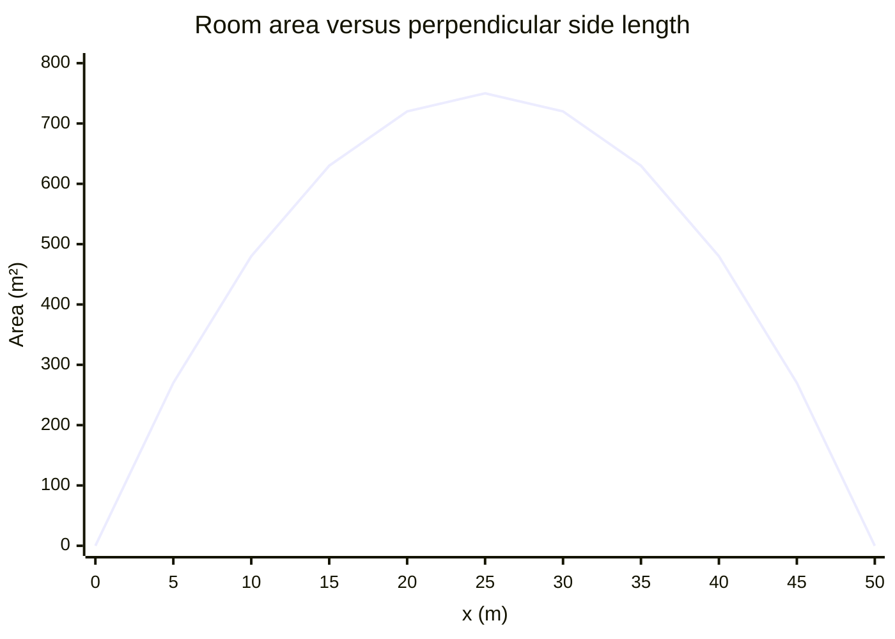

# Problem 12. Complete Model and Computer Verification

## The question

A museum wants to create a rectangular exhibition room next to an existing straight wall. The side along the wall does not need to be built. The remaining three sides are to be constructed to two different standards: the two sides perpendicular to the wall cost $300\ \mathrm{PLN/m}$ each, while the side parallel to the wall costs $500\ \mathrm{PLN/m}$. The budget is $30\,000\ \mathrm{PLN}$.

Build a model that maximizes the area of the room and prepare a complete analysis containing:

- definition of variables and units,
- mathematical model,
- domain resulting from the problem statement,
- computation of the derivative,
- determination and verification of the optimum,
- interpretation of the result,
- graph of the objective function,
- numerical verification of several values near the optimum found.

Finally, indicate which part of the solution required modeling the problem and which part was only the execution of the calculation. Produce the graph and computer calculations only after completing the mathematical solution, and treat them as verification.

## Before calculating: define the variables and distinguish the costs

Let $x$ meters be each perpendicular side's length, and $y$ meters the built parallel side's length. Both are positive. The existing wall supplies the fourth side at no construction cost. We maximize area under the available budget, not minimize the perimeter.

Modeling includes the resource inequality, not only a formula substituted into a derivative. The reason the budget is fully used must be justified by the area increasing when an affordable side grows. The domain comes from both dimensions being positive. A graph and numerical table verify the analytical optimum but cannot alone prove it is globally best.

## 1. Build the model and physical domain

The cost constraint is $600x+500y\le30000$ PLN. At an optimum the whole budget is used: if there were unused budget and $x>0$, increasing $y$ would increase area. Therefore

$$600x+500y=30000\Longrightarrow y=60-\frac65x.$$

Thus

$$\boxed{A(x)=xy=60x-\frac65x^2\ \mathrm m^2,\qquad0<x<50\ \mathrm m}.$$

The domain comes from $x>0$ and $y>0$, not from the polynomial formula, which would otherwise allow nonphysical lengths.

## 2. Find and verify the optimum analytically

$$A'(x)=60-\frac{12}{5}x=0\Longrightarrow x=25.$$

Then $y=60-30=30$. Since $A''=-12/5<0$, and $A'$ changes from positive to negative, this is the unique maximum. The endpoint limits give zero area. Equivalently,

$$A(x)=750-\frac65(x-25)^2\le750.$$

Therefore $\boxed{x=25\ \mathrm m,\quad y=30\ \mathrm m,\quad A_{\max}=750\ \mathrm m^2}$.

## 3. Explain why unequal lengths can still balance the budget

The cost equation has coefficients $600$ for the pair of perpendicular sides per unit $x$ and $500$ for the parallel side per unit $y$. At the optimum, these two total cost contributions are equal even though the side lengths are not.

From $A'=0$, $60-(12/5)x=0$ gives $x=25$, and the budget forces $y=30$. The products $600x=15000$ and $500y=15000$ verify the balance. Equal total expenditure does not mean equal per-meter costs or equal side lengths.

The exact loss formula $750-A(x)=(6/5)(x-25)^2$ shows that every admissible departure from $25$ lowers area, not only the sampled values. It proves uniqueness globally and explains the numerical graph's symmetry. The computer table is therefore an independent arithmetic check of a fully established optimum, not an estimate used in place of a proof.

## 4. Interpret and check the physical result

The two perpendicular sides cost $2\cdot300\cdot25=15000$ PLN; the parallel side costs $500\cdot30=15000$ PLN. Their sum is exactly the budget. The optimal dimensions are unequal because the side costs are unequal and one wall is already present.

Defining the side lengths, counting the two different costs, using the full budget, and restricting the domain are the modeling steps. Solving $A'=0$ and evaluating the concavity and area are subsequent calculus steps.

## 5. Computer verification after the analytical solution

The following table evaluates $y=60-1.2x$ and $A=xy$ numerically near the proved optimum. It is a check, not the reason for selecting the dimensions.

| x (m) | y (m) | Area (m²) |
|---|---|---|
| 24.0 | 31.2 | 748.8 |
| 24.5 | 30.6 | 749.7 |
| 25.0 | 30.0 | 750.0 |
| 25.5 | 29.4 | 749.7 |
| 26.0 | 28.8 | 748.8 |

The graph samples the objective over the closed interval $[0,50]$ for display. Its endpoints represent degenerate limiting rooms and are not part of the physical domain.

For an exact independent numerical-error check, $750-A(x)=1.2(x-25)^2$: deviations of $0.5$ m and $1$ m reduce area by $0.3$ and $1.2$ square meters, respectively. The table and symmetric graph agree with this identity and with the global calculus analysis.
